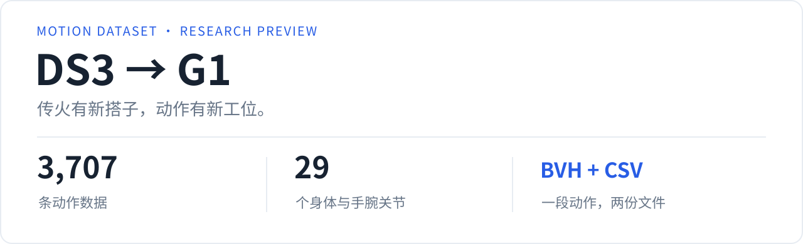
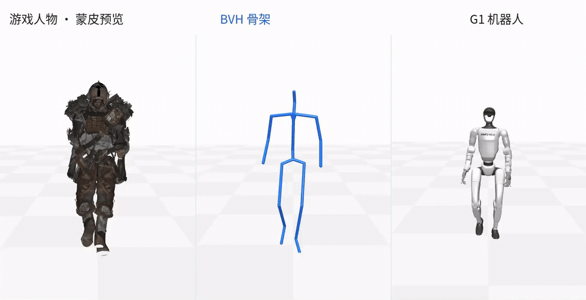
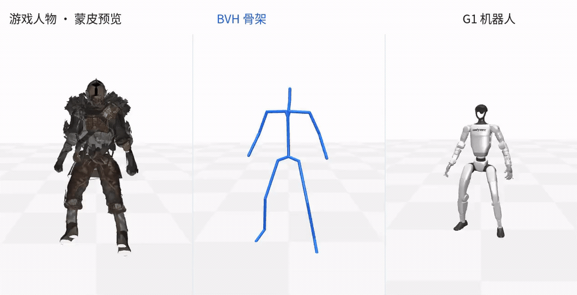
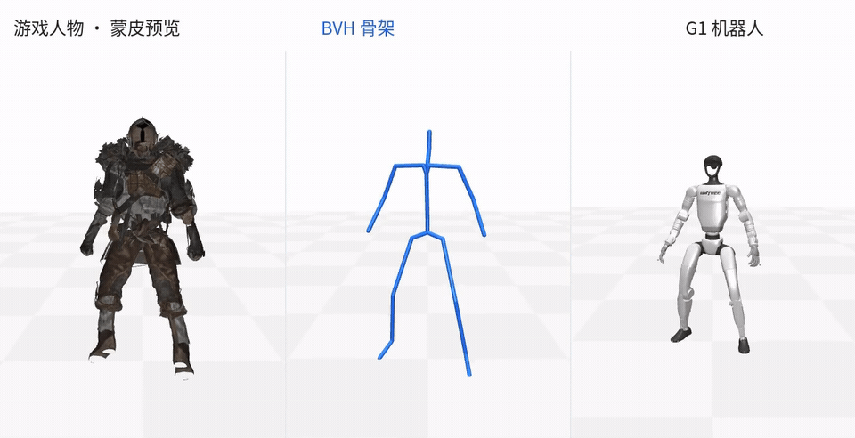

<div align="center">

[简体中文](README.md) | [English](README_EN.md)



**以前传火，现在给 G1 加戏。**

</div>

## 动作内容

《黑暗之魂 III》主角动画重定向到 Unitree G1 的 **3,707 条动作数据**。每条动作提供 **BVH 人体骨架 + CSV 的 G1 动作**，保留片段自身的帧率和时长。

| 类型 | 动作示例 | 今日机器人精神状态 |
|---|---|---|
| 移动 | 步行、跑步、侧移、转身 | 老板来了切跑步，需求变了先转身 |
| 战斗 | 攻击、防御、后撤、翻滚 | 气势拉满，隔壁工位先别拆 |
| 社交与姿态 | 挥手、鞠躬、欢呼、赞美太阳 | 情绪价值，也是生产力 |
| 交互与状态 | 使用道具、休息、受击反应 | 不是摆烂，是状态机正在上班 |

3,707 是动作片段数，不代表 3,707 种不同的行为；同名片段和变体没有合并或去重。

下面的动图从左到右为 **游戏人物蒙皮预览 / BVH 骨架 / G1 机器人**，对应同一动作的同一时间点。均为离线动画展示，不是游戏实时录屏或实机演示。

**移动：方向灵活，主打一个随时转场。**



**战斗：架势到位，工位保重。**



**赞美太阳：跨界打工，也要有仪式感。**



## 目录介绍

```text
ds3-g1-motions/
├── README.md / README_EN.md   # 中英文介绍
├── motions/                  # 完整动作数据，按批次与动作分目录
│   └── batch_02/
│       └── Wave__c0000_a00_hi__1082_a000_081100/
│           ├── motion.bvh    # 人体骨架动画
│           └── motion.csv    # G1 机器人动作
├── catalog/                  # 每段的帧数、帧率、时长、路径与文件哈希
├── splits/kept.txt            # 当前 3,707 条动作清单
├── data/schema.json          # 骨架约定、单位与 G1 的 CSV 列顺序
├── docs/                     # 格式说明和对比动图
└── tools/                    # 数据校验与单动作信息查看
```

BVH 和 CSV 对应同一片段，但骨架、单位和坐标系不同；CSV 包含根位置、根朝向及 29 个身体与手腕关节，不含手指数据。详细约定见 [格式说明](docs/FORMAT.md)。

项目包含动作数据与上述对比动图，动作仍可能有脚滑、轻微穿地或姿态差异；。

**愿你的机器人，动作够多，脚踏实地。今天先收藏，明天再挑战早八。**
