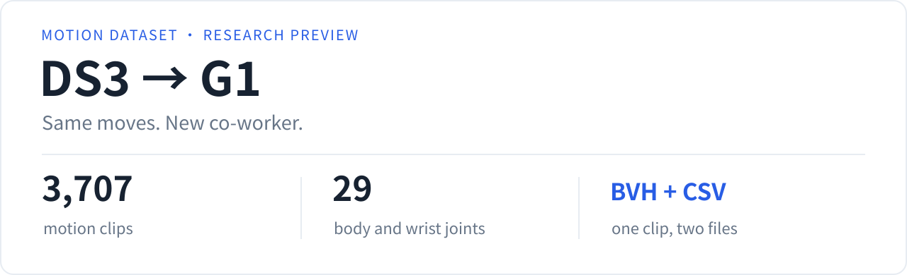
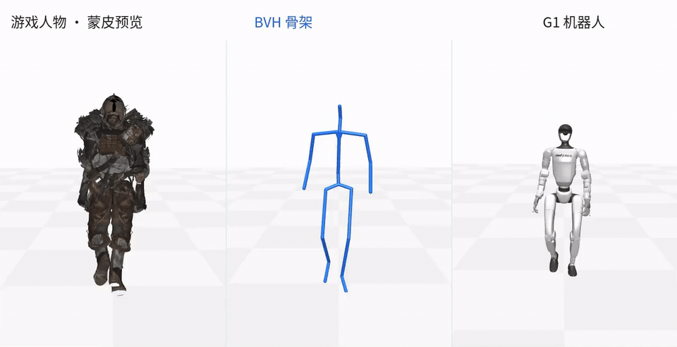
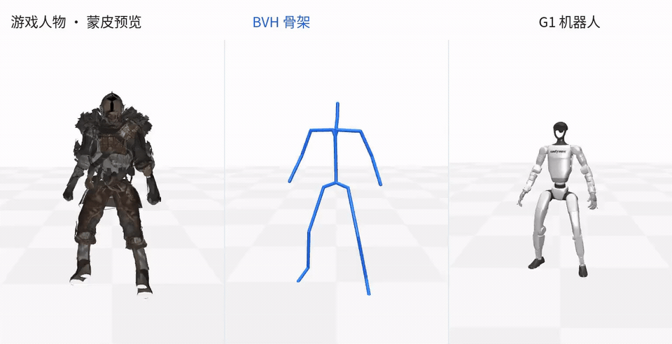
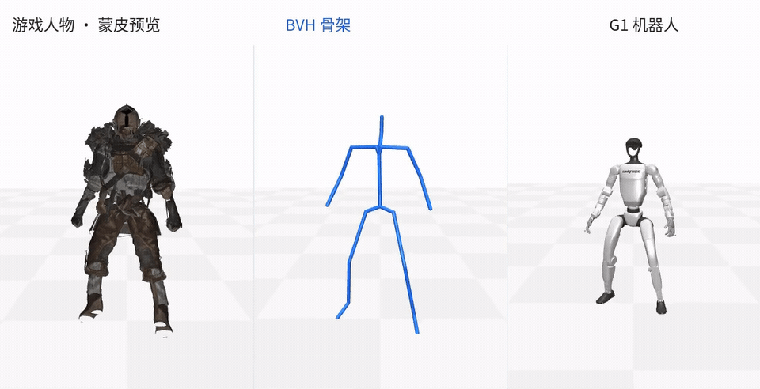

<div align="center">

[简体中文](README.md) | [English](README_EN.md)



**Once linked the fire. Now bringing the moves to G1.**

</div>

## Motion content

**3,707 motion clips** retargeted from the **Dark Souls III** player character to **Unitree G1**. Every clip comes as **human-skeleton BVH + G1 motion CSV**, retaining its own frame rate and duration.

| Type | Examples | Robot's current mood |
|---|---|---|
| Locomotion | Walking, running, sidestepping, turning | Boss approaching? Run. Requirements changed? Turn around. |
| Combat | Attacks, guards, backsteps, rolls | Maximum presence. Minimum office demolition. |
| Gestures and poses | Waving, bowing, cheering, Praise the Sun | Emotional value is still value. |
| Interactions and states | Item use, resting, hit reactions | Not slacking. Just an expressive state machine. |

The count is 3,707 clips, not 3,707 distinct behaviors. Same-name clips and variants have not been merged or deduplicated.

The GIFs show **the skinned game character / the BVH skeleton / the G1 robot**, from left to right, synchronized to the same moment of a motion. These are offline animation previews, not live game recordings or hardware footage.

**Locomotion: ready for a change of direction, especially at work.**



**Combat: bring the stance, spare the office furniture.**



**Praise the Sun: even a career change deserves a little ceremony.**



## Repository layout

```text
ds3-g1-motions/
├── README.md / README_EN.md   # Chinese / English introduction
├── motions/                  # Complete motion data by batch and clip
│   └── batch_02/
│       └── Wave__c0000_a00_hi__1082_a000_081100/
│           ├── motion.bvh    # Human-skeleton animation
│           └── motion.csv    # G1 robot motion
├── catalog/                  # Frames, FPS, duration, paths, and hashes
├── splits/kept.txt            # Current set of 3,707 motion keys
├── data/schema.json          # Skeleton conventions, units, G1 CSV column order
├── docs/                     # Format guides and comparison GIFs
└── tools/                    # Validation and single-motion inspection
```

BVH and CSV represent the same clip but use different skeletons, units, and coordinate systems. There are no per-clip NPZ or JSON files. CSV contains root position, root orientation, and 29 body/wrist joint angles, without finger data. See the [format guide](docs/FORMAT_EN.md).

The project includes motion data and the comparison GIFs above, not game-character meshes, textures, robot models, voice audio, or a complete retargeting pipeline. Sliding, minor ground penetration, and pose differences can remain. Playback does not establish hardware readiness.

**May your robot have plenty of moves—and keep its feet on the ground. Bookmark today. Face the morning meeting tomorrow.**
